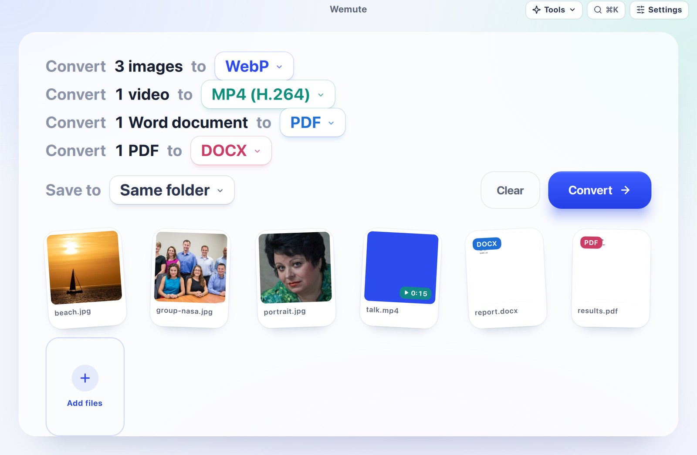
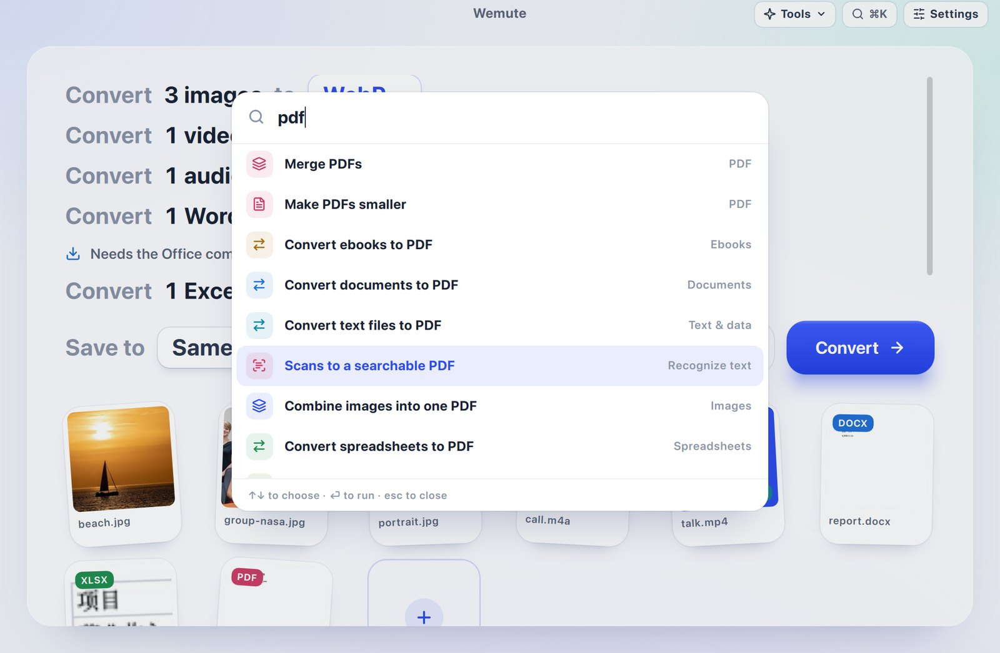

# Wemute

**Drop files in, read one sentence, convert.** Wemute is a converter for the
Mac that works entirely on your computer. It converts images, video, audio,
documents, spreadsheets, slides, PDFs, e-books, archives, fonts and data, and
adds photo and scanning tools built on Apple's own frameworks. It also has a
command line that turns any file into text a language model can read.

[中文说明](README.zh.md) · [Command line reference](docs/cli.md) · License: [AGPL-3.0](LICENSE)



## What it does

Drop any mix of files. Each kind gets one line, such as *Convert 3 images to
[WebP ▾]*. Change the format in that line, then press **Convert**. Your
choices are remembered, outputs never overwrite anything, and nothing leaves
your Mac.

| Files | Become |
|---|---|
| Images (HEIC, JPG, PNG, WebP, AVIF, TIFF, GIF, BMP, RAW) | any of those, one PDF, a ZIP |
| Video (MOV, MP4, MKV, WebM, AVI) | MP4 H.264/H.265 (hardware encoded), ProRes, MKV, WebM, GIF, subtitles |
| Audio (WAV, MP3, M4A, FLAC, AIFF, OGG, Opus) | any of those, a transcript |
| Word, Pages, RTF, ODT | PDF, DOCX, ODT, RTF, TXT, HTML |
| Excel, Numbers, CSV | XLSX, CSV, JSON, PDF, ODS |
| PowerPoint, Keynote | PDF, PPTX, ODP, one PNG per slide |
| PDF | Word, page images, text, a smaller PDF, merged PDFs, searchable PDFs |
| E-books (EPUB, MOBI, AZW3) | EPUB, MOBI, AZW3, PDF |
| Markdown, HTML, JSON | DOCX, PDF, HTML, CSV, XLSX |
| Fonts, SVG, archives | WOFF2/TTF/OTF/WOFF, PNG/PDF, extracted folders |


### Photo and scan tools on Apple's frameworks

These need no download and run on the Neural Engine:

- **Remove background**: Apple's subject cut-out, with clean hair edges.
- **ID photo**: a white, blue or red backdrop. The old backdrop between loose
  strands of hair is removed as well.
- **Portrait blur**: blurs the background and keeps the subject sharp.
- **Text recognition (OCR)**: Chinese and English, to text, Word or a
  searchable PDF. Scanned PDFs become searchable.
- **Scan and flatten**: turns a phone photo of a page into a straight,
  cropped scan, in colour or black and white.
- **Smart crop** to 1:1, 4:5, 16:9 or 9:16 around the subject; **blur or
  pixelate faces**; **straighten** a tilted horizon; **read QR codes and
  barcodes**; **find blurry and duplicate photos** in a batch.
- **Quick Look thumbnails** for every file in the list.


### Optional local models

These are downloaded only when you first use them:

- **Upscale** 2× or 4× (Real-ESRGAN).
- **Erase**: paint over something to remove it (LaMa). It works best on text,
  watermarks and small objects. A person in front of a busy background may
  smear.
- **Separate vocals** from music (Demucs on MLX).

### Subtitles and read-aloud, with ThunderTalk

With [ThunderTalk](https://github.com/realAllenSong/ThunderTalk) installed,
Wemute uses its speech models:

- **Subtitles** from video and audio: SRT, VTT, a transcript, or a transcript
  that labels each speaker for calls and meetings. Transcription uses the most
  accurate model you have downloaded.
- **Read aloud**: text, Markdown, Word and PDF become M4A, read by VoxCPM2.

### Find every tool

Every tool can be found three ways:

- the **Tools** menu;
- the **⌘K** search, which understands "to pdf", "去背景" and "ocr";
- the macOS menu bar.

Choose a tool with no files open, and the next drop uses it.

| | |
|---|---|
|  |  |

### Finder, Shortcuts and settings

**Settings › Integrations** offers:

- **Finder Quick Actions**: right-click › Quick Actions › *Wemute: Remove
  Background*, *Convert to PDF*, *Make Subtitles* and more.
- **Shortcuts**: a *Convert with Wemute* shortcut.
- **The `wemute` command** for the command line.

The **Settings** window also has light, dark and system appearance, a default
format for every kind of file, the save location, and optional components.


## For scripts and AI agents

`wemute extract` turns any file or folder into Markdown, plain text or JSON
lines that a language model can read:

- PDFs keep their pages and tables; scanned pages are read with OCR.
- Word, Excel and PowerPoint keep their headings, sheets, slides and notes.
- Screenshots and photos are read with OCR.
- Recordings become transcripts with timestamps, and can label each speaker.
- E-mails, archives and folders are read file by file.

```sh
wemute extract quarterly-report.pdf                  # Markdown on stdout
wemute extract earnings-call.m4a --speakers          # who said what, with timestamps
wemute extract research/ --format json > docs.jsonl  # one JSON document per file
wemute convert --action remove_background *.jpg      # any tool, without the window
```

stdout carries only results, the exit status is 0 or 1, and errors have stable
codes. See the [command line reference](docs/cli.md).

## Install

Wemute needs macOS 14 or later on Apple Silicon. There is no signed download
yet, so build the app from source:

```sh
git clone https://github.com/realAllenSong/wemute.git && cd wemute
uv sync --dev
uv run wemute                      # run from source
./scripts/build-macos.sh           # build dist/Wemute.app (bundles FFmpeg)
```

These parts are not bundled and are offered when a file needs them:

| Component | Size | Used for |
|---|---|---|
| LibreOffice | ~300 MB | Office documents, Pages, Numbers, Keynote |
| Calibre | ~360 MB | MOBI and AZW3 |
| Pandoc | ~40 MB | Markdown and HTML to Word |

Each component is downloaded from its official source and its SHA-256 is
checked. You can remove any of them in **Settings › Components**.

## Privacy

Wemute has no account, no uploads and no telemetry. Files are converted by
processes on your Mac. Network access is used only to download a component or
a model that you choose, and to check for app updates.

## Development

```sh
uv run pytest                          # unit and integration tests
uv run python -m wemute --smoke-test   # loads the full interface and exits
```

- `src/wemute/`: the app (PySide6 and QML) and its workers. The conversion
  engines are in `engines/`. `extract.py` and `cli.py` are the command line.
- `apps/web/`: the browser edition, an Astro site whose tools run in the
  browser.
- `docs/plans/`: design notes for each round of work.

## License

Wemute is free software under the [GNU Affero General Public License
v3.0](LICENSE). The bundled and optional third-party software keeps its own
license. **Settings › About** lists each one with a link.
