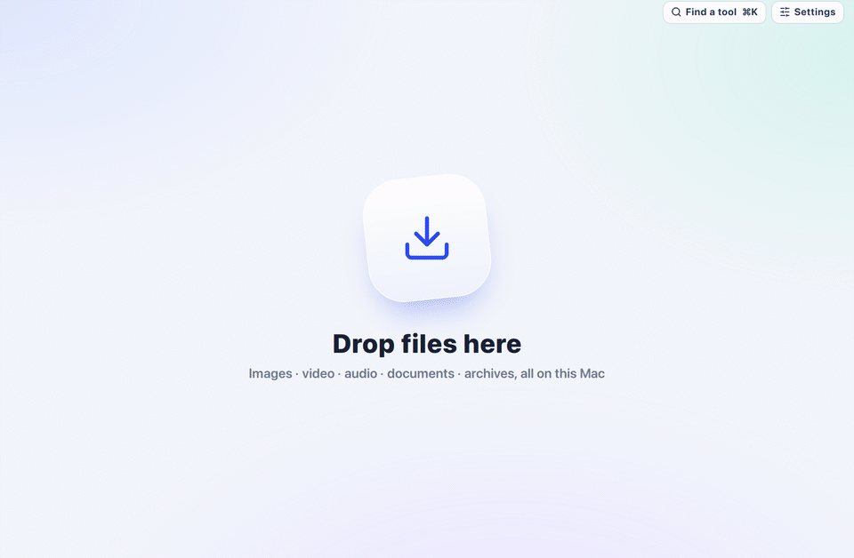
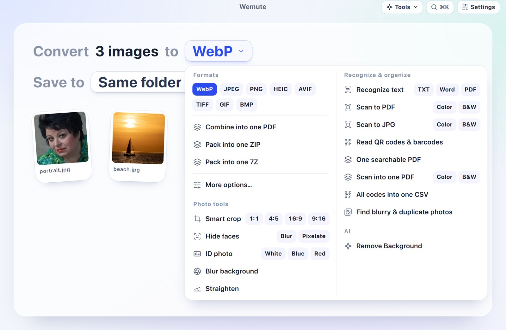
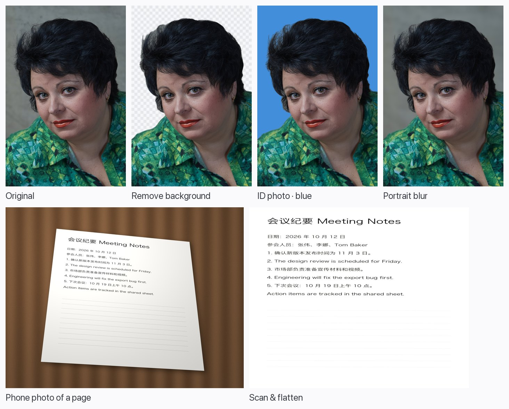
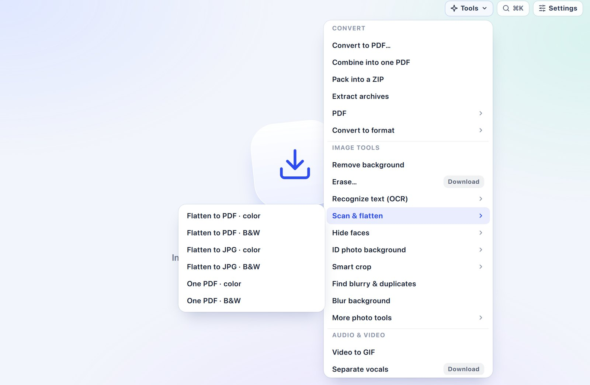
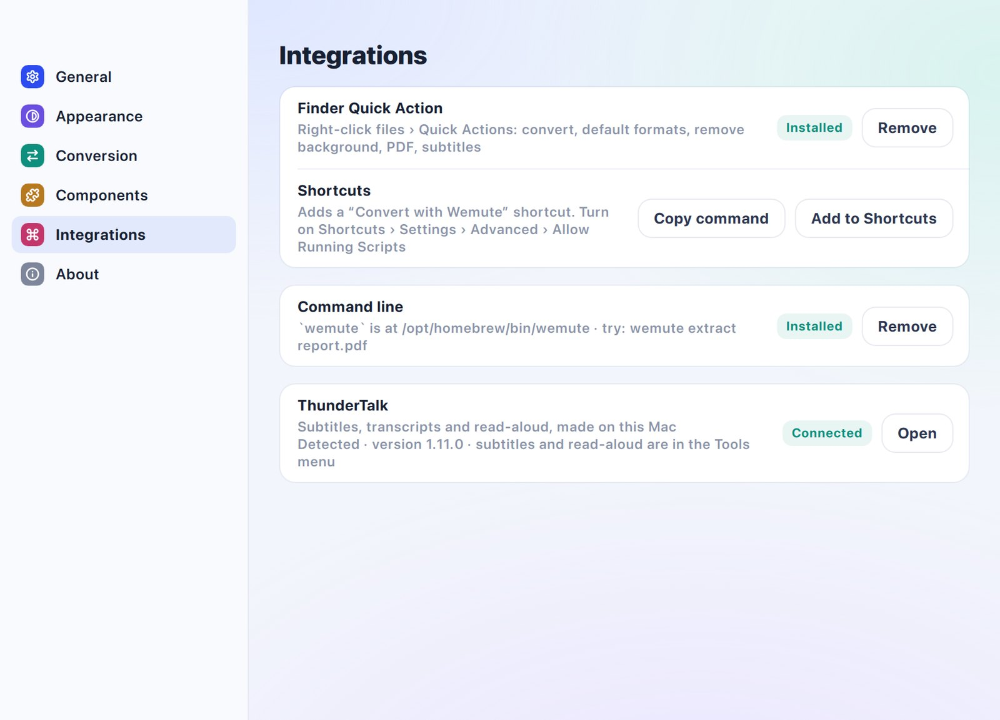

<p align="center">
  
</p>

<h1 align="center">Wemute</h1>

<p align="center">
  Free, open-source file converter for the Mac.<br/>
  Drop in any files, read one sentence, convert.<br/>
  Everything runs on your Mac: no account, no uploads, no cloud.
</p>

<p align="center">
  <a href="README.zh.md">中文文档</a> · <a href="https://wemute.entropinia.com">Website</a> · <a href="https://github.com/realAllenSong/wemute/releases/latest">Download</a> · <a href="docs/cli.md">Command line</a>
</p>

<p align="center">
  <a href="LICENSE"></a>
  
  <a href="https://github.com/realAllenSong/wemute/releases/latest"></a>
  <a href="https://github.com/realAllenSong/wemute/releases"></a>
</p>

<p align="center">
  
  <br/><sub>Real screenshots of Wemute 0.7.1 on macOS 15. The conversions in the last frame really ran on an M3 Max; only the cross-fades are added.</sub>
</p>

---

Wemute is a converter for the Mac. Drop in a mix of files: each kind gets one
line, such as *Convert 3 images to [WebP ▾]*. Change the format in the line,
press **Convert**, and the results appear next to the originals.

It handles images, video, audio, Word, Excel, PowerPoint, Pages, Numbers,
Keynote, PDF, e-books, archives, fonts and data. It adds photo and scanning
tools built on Apple's Vision framework, and a command line that turns any
file into text a language model can read.

Wemute is AGPL licensed. It is an open-source, offline alternative to
Permute, CloudConvert, Convertio, iLovePDF and other online converters.

The interface is "Ice": soft glass on a pale background, one cobalt accent,
and light and dark modes. There are no settings to learn before your first
conversion.

## New in v0.7.2

- **Downloads that work everywhere.** The app now carries its own HTTPS
  certificates. Before, Macs without Homebrew could not download models or
  components.
- **Downloads that never hang.** A stalled connection gives up after 30
  seconds and moves on to a mirror. The Erase and Upscale models now come
  from Wemute's own GitHub mirror first.
- **`wemute models` and `wemute doctor`:** install models from the command
  line, and check what works on this Mac.

## New in v0.7.1

- **One place for every tool:** the toolbar's Tools menu and ⌘K search showed the same tools, so the Tools menu is gone. **Find a tool ⌘K** searches every tool, and shows the full list when you type nothing.

## New in v0.7.0

- **First signed release.** Wemute is signed with a Developer ID and notarized
  by Apple, and it updates itself through Sparkle.
- **`wemute extract`** turns any file or folder into Markdown, text or JSON
  lines for language models. It reads:
  - PDF pages and tables, with OCR for scanned pages;
  - Word headings, Excel sheets, and slides with their speaker notes;
  - screenshots;
  - call recordings, with speaker labels;
  - e-mails with their attachments, and archives.

  See [For scripts and AI agents](#for-scripts-and-ai-agents).
- **Subtitles and read-aloud through ThunderTalk.** Subtitles can be SRT,
  VTT, a transcript, or a transcript that labels each speaker. Transcription
  uses the most accurate model you have downloaded. Read-aloud uses VoxCPM2.
- **Better photo tools:**
  - ID photos and the new portrait blur use Apple's subject cut-out, and keep
    loose hair clean on red and blue backdrops.
  - Erase no longer leaves a ghost or a dark smear on larger objects.
- **Built into macOS:** Finder Quick Actions, a Shortcuts action, a `wemute`
  shell command, a Settings window, the native menu bar, and ⌘K search.

## Features

### Convert almost anything

| Files | Become |
|---|---|
| Images: HEIC, JPG, PNG, WebP, AVIF, TIFF, GIF, BMP, RAW | any of those, one PDF, a ZIP |
| Video: MOV, MP4, MKV, WebM, AVI | MP4 H.264 or H.265 (hardware encoded), ProRes, MKV, WebM, GIF, subtitles |
| Audio: WAV, MP3, M4A, FLAC, AIFF, OGG, Opus | any of those, a transcript |
| Word, Pages, RTF, ODT | PDF, DOCX, ODT, RTF, TXT, HTML |
| Excel, Numbers, CSV | XLSX, CSV, JSON, PDF, ODS |
| PowerPoint, Keynote | PDF, PPTX, ODP, one PNG per slide |
| PDF | Word, page images, text, a smaller PDF, merged PDFs, searchable PDFs |
| E-books: EPUB, MOBI, AZW3 | EPUB, MOBI, AZW3, PDF |
| Markdown, HTML, JSON | DOCX, PDF, HTML, CSV, XLSX |
| Fonts, SVG, archives | WOFF2, TTF, OTF, WOFF; PNG, PDF; extracted folders |

- **Defaults are remembered.** Every kind of file has a default format in
  Settings, and each choice you make becomes the next default.
- **Outputs never overwrite anything.** Save to the same folder as the
  original or to a folder you choose. You can add a "-wemute" suffix to every
  output name.
- **Batches run in parallel.** Images use several cores, video uses the
  hardware encoder, and documents run in their own queue.

<p align="center"></p>

### Photo and scan tools on Apple's frameworks

These need no download and run on the Neural Engine:

- **Remove background:** Apple's subject cut-out, with clean hair edges.
- **ID photo:** a white, blue or red backdrop. The old backdrop between loose
  strands of hair is removed as well.
- **Portrait blur:** blurs the background and keeps the subject sharp.
- **Recognize text (OCR):** Chinese and English, to text, Word or a
  searchable PDF. Scanned PDFs become searchable.
- **Scan and flatten:** turns a phone photo of a page into a straight,
  cropped scan, in colour or black and white.
- **Smart crop** to 1:1, 4:5, 16:9 or 9:16 around the subject.
- **Blur or pixelate faces.**
- **Straighten** a tilted horizon.
- **Read QR codes and barcodes.**
- **Find blurry and duplicate photos** in a batch.

<p align="center"></p>

### Optional local models

These are downloaded only when you first use them:

- **Upscale** 2× or 4× (Real-ESRGAN).
- **Erase:** paint over something to remove it (LaMa). It works best on text,
  watermarks and small objects. A person in front of a busy background may
  smear.
- **Separate vocals** from music (Demucs on MLX).

### Subtitles and read-aloud, with ThunderTalk

When [ThunderTalk](https://github.com/realAllenSong/ThunderTalk) is
installed, Wemute offers two more choices:

- **Subtitles**, for video and audio: SRT, VTT, a transcript, or a transcript
  that labels each speaker. They are made with ThunderTalk's most accurate
  downloaded model.
- **Read aloud**, for text, Markdown, Word and PDF files: an M4A read by
  VoxCPM2.

Once Wemute finds ThunderTalk, **Settings › Integrations** shows it as
**Connected**.

### Built into macOS

- **⌘K, the *Find a tool* button:** type "to pdf", "去背景" or "ocr", or
  scroll the full list. The **Tools** menu in the menu bar lists the same
  tools. Choose a tool before dropping files, and the next drop uses it.
- **Finder Quick Actions:** right-click files › Quick Actions ›
  *Wemute: Remove Background*, *Convert to PDF*, *Make Subtitles* and more.
- **Shortcuts:** a *Convert with Wemute* shortcut for your automations.
- **The Settings window:** light, dark or system appearance, a default format
  for every kind of file, the save location, and optional components.
- **Quick Look:** every file shows a thumbnail; press Space to preview it.

| | |
|---|---|
|  |  |

## For scripts and AI agents

`wemute extract` turns any file or folder into Markdown, plain text or JSON
lines that a language model can read. Use it on research reports, earnings
calls, screenshots, spreadsheets and e-mails.

```sh
wemute extract quarterly-report.pdf                  # Markdown on stdout
wemute extract earnings-call.m4a --speakers          # who said what, with timestamps
wemute extract research/ --format json > docs.jsonl  # one JSON document per file
wemute convert --action remove_background *.jpg      # any tool, without the window
wemute actions                                       # every tool id
```

- stdout carries only results; library logs go to stderr.
- The exit status is 0 or 1, and errors have stable codes.
- Every file type has an acceptance test that runs against the packaged app.

Install the command from **Settings › Integrations › Command line**. The full
reference is in [docs/cli.md](docs/cli.md).

## Install

1. Download the `.dmg` from the
   [latest release](https://github.com/realAllenSong/wemute/releases/latest).
2. Open it and drag Wemute to Applications.
3. Drop files on the window.

Wemute needs macOS 14 or later on Apple Silicon. It is signed with a Developer
ID and notarized by Apple, so it opens without warnings and updates itself.

These parts are not bundled. Wemute offers them the first time a file needs
them:

| Component | Size | Used for |
|---|---|---|
| LibreOffice | ~300 MB | Office documents, Pages, Numbers, Keynote |
| Calibre | ~360 MB | MOBI and AZW3 |
| Pandoc | ~40 MB | Markdown and HTML to Word |

Each component is downloaded from its official source and checked against a
pinned SHA-256. You can remove any of them in **Settings › Components**.

### Build from source

```sh
git clone https://github.com/realAllenSong/wemute.git && cd wemute
uv sync --dev
uv run wemute                      # run from source
./scripts/build-macos.sh           # build dist/Wemute.app (bundles FFmpeg)
./scripts/package-macos.sh         # signed, notarized DMG (needs a Developer ID)
```

## On the web

The most common image, video and audio conversions also run in the browser at
[wemute.entropinia.com](https://wemute.entropinia.com). Nothing is uploaded:
images use the browser's encoder, and video uses FFmpeg compiled to
WebAssembly. The site's source is in [`apps/web`](apps/web).

## Privacy

Wemute has no account, no uploads and no telemetry. Files are converted by
processes on your Mac. Wemute goes online only to download a component or
model you choose, and to check for app updates.

## Development

```sh
uv run pytest                          # unit and integration tests
uv run python -m wemute --smoke-test   # loads the full interface and exits
```

- `src/wemute/`: the app (PySide6 and QML) and its workers.
  - `engines/`: the converters.
  - `extract.py` and `cli.py`: the command line.
- `apps/web/`: the browser edition, an Astro site with 119 browser tests.
- `docs/plans/`: design notes for each round of work.

## License

Wemute is free software under the [GNU Affero General Public License
v3.0](LICENSE).

It builds on these projects, which keep their own licenses:

- Apple's Vision and Core Image frameworks;
- FFmpeg, LibreOffice, Calibre and Pandoc;
- PyMuPDF and pdfium;
- LaMa, Real-ESRGAN and Demucs;
- Qt for Python;
- Sparkle.

**Settings › About** lists each one with a link to its license.
