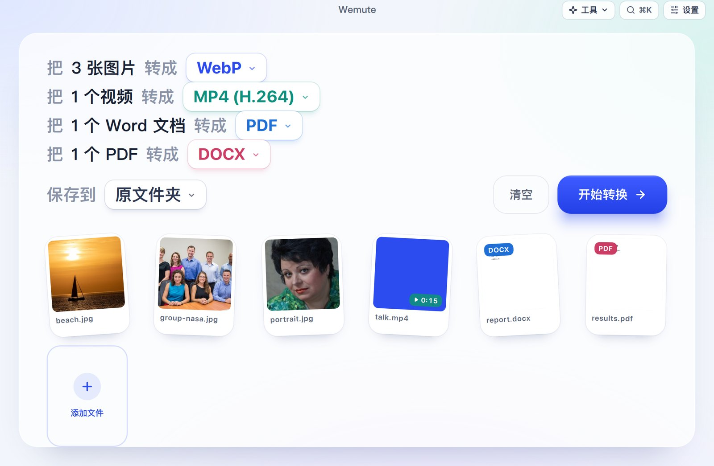
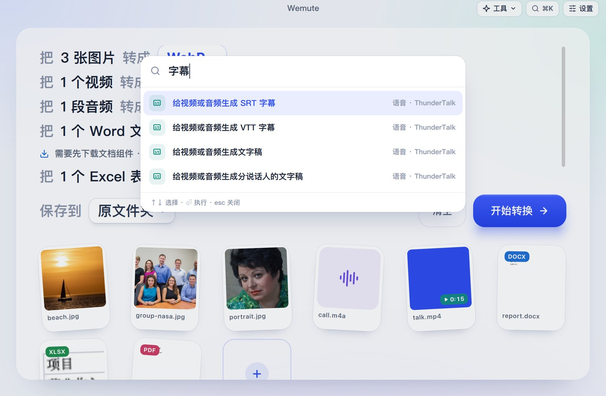

# Wemute

**拖进文件，读一句话，开始转换。** Wemute 是一个完全在本机运行的 Mac 转换工具。

- 能转换图片、视频、音频、文档、表格、演示文稿、PDF、电子书、压缩包、字体和数据。
- 带一组基于 Apple 原生框架的照片和扫描工具。
- 命令行能把任何文件变成大模型能读的文字。

[English](README.md) · [命令行参考](docs/cli.md) · 许可证：[AGPL-3.0](LICENSE)



## 能做什么

随便拖进一批文件。每种文件占一行，比如「把 3 张图片 转成 [WebP ▾]」。在这一行里换格式，然后按**开始转换**。

- 你的选择会被记住。
- 输出不会覆盖任何文件。
- 文件不会离开你的 Mac。

| 文件 | 可以变成 |
|---|---|
| 图片（HEIC、JPG、PNG、WebP、AVIF、TIFF、GIF、BMP、RAW） | 上述任意格式、合成一个 PDF、打包 ZIP |
| 视频（MOV、MP4、MKV、WebM、AVI） | MP4 H.264/H.265（硬件编码）、ProRes、MKV、WebM、GIF、字幕 |
| 音频（WAV、MP3、M4A、FLAC、AIFF、OGG、Opus） | 上述任意格式、文字稿 |
| Word、Pages、RTF、ODT | PDF、DOCX、ODT、RTF、TXT、HTML |
| Excel、Numbers、CSV | XLSX、CSV、JSON、PDF、ODS |
| PowerPoint、Keynote | PDF、PPTX、ODP、每页一张 PNG |
| PDF | Word、页面图片、文字、压缩 PDF、合并 PDF、可搜索 PDF |
| 电子书（EPUB、MOBI、AZW3） | EPUB、MOBI、AZW3、PDF |
| Markdown、HTML、JSON | DOCX、PDF、HTML、CSV、XLSX |
| 字体、SVG、压缩包 | WOFF2/TTF/OTF/WOFF、PNG/PDF、解压后的文件夹 |


### 基于 Apple 框架的照片和扫描工具

这些工具不用下载任何东西，在神经网络引擎上运行：

- **去背景**：Apple 的主体抠图，发丝边缘干净。
- **证件照换底**：白、蓝、红三种底色，发丝间露出的旧背景也会一起去掉。
- **背景虚化**：背景模糊，人物保持清晰。
- **文字识别（OCR）**：识别中英文，输出文字、Word 或可搜索的 PDF；扫描版 PDF 也能变成可搜索的。
- **扫描矫正**：手机拍的纸张，拉平、裁边成扫描件，可选彩色或黑白。
- **其他照片工具**：
  - 围绕主体**智能裁剪**成 1:1、4:5、16:9、9:16；
  - **人脸打码**（模糊或马赛克）；
  - 自动**扶正**歪的照片；
  - **识别二维码和条码**；
  - 从一批照片里**挑出模糊和重复**的。
- 文件列表里每个文件都显示 **Quick Look 缩略图**。


### 可选的本地模型

第一次用到时才下载：

- **图片放大** 2× 或 4×（Real-ESRGAN）。
- **擦除**：涂抹想去掉的东西（LaMa）。最适合文字、水印和小物体；复杂背景前的人物可能会糊。
- **人声分离**（Demucs，在 MLX 上运行）。

### 字幕和朗读（借助 ThunderTalk）

装了 [ThunderTalk](https://github.com/realAllenSong/ThunderTalk) 以后，Wemute 会用它的语音模型：

- **字幕**：视频和音频可以生成 SRT、VTT、文字稿，或者分说话人的文字稿，适合电话会和会议。转写用你下载的最准的模型。
- **朗读**：TXT、Markdown、Word、PDF 可以用 VoxCPM2 读成 M4A。

### 每个工具都找得到

每个工具都有三个入口：

- 右上角的**工具**菜单；
- **⌘K** 搜索，"转 pdf""去背景""ocr"都能找到；
- macOS 菜单栏。

没有打开文件时先选好工具，下一次拖进来的文件就直接用它。

| | |
|---|---|
|  |  |

### 访达、快捷指令和设置

**设置 › 集成**里可以装三样东西：

- **访达快速操作**：右键文件 › 快速操作 ›「Wemute：去背景」「转成 PDF」「生成字幕」等。
- **快捷指令**：一个「Wemute 转换」快捷指令。
- **`wemute` 命令行工具**。

**设置**窗口还可以设置：

- 外观：浅色、深色或跟随系统；
- 每种文件的默认格式；
- 保存位置；
- 可选组件。


## 给脚本和 AI 智能体用

`wemute extract` 能把任何文件或文件夹变成大模型能读的 Markdown、纯文本或 JSON 行：

- **PDF**：保留分页和表格，扫描页自动 OCR。
- **Word、Excel、PPT**：保留标题、工作表、幻灯片和备注。
- **截图和照片**：用 OCR 识别文字。
- **录音**：变成带时间戳的文字稿，可以标出说话人。
- **邮件、压缩包、文件夹**：逐个文件展开。

```sh
wemute extract 季度报告.pdf                    # Markdown 输出到 stdout
wemute extract 业绩电话会.m4a --speakers       # 谁说了什么，带时间戳
wemute extract 研究资料/ --format json > docs.jsonl   # 每个文件一行 JSON
wemute convert --action remove_background *.jpg      # 不开窗口，调用任意工具
```

stdout 只输出结果，退出码是 0 或 1，错误码稳定。详见[命令行参考](docs/cli.md)。

## 安装

需要 macOS 14 或更高版本，Apple 芯片。目前还没有签名的安装包，请从源码构建：

```sh
git clone https://github.com/realAllenSong/wemute.git && cd wemute
uv sync --dev
uv run wemute                      # 从源码运行
./scripts/build-macos.sh           # 构建 dist/Wemute.app（自带 FFmpeg）
```

下面这些不随 app 打包，文件需要时才提示下载：

| 组件 | 大小 | 用途 |
|---|---|---|
| LibreOffice | 约 300 MB | Office 文档、Pages、Numbers、Keynote |
| Calibre | 约 360 MB | MOBI、AZW3 |
| Pandoc | 约 40 MB | Markdown、网页转 Word |

每个组件都从官方来源下载，并校验 SHA-256。可以在**设置 › 组件**里随时移除。

## 隐私

不需要账号，不上传文件，不收集遥测。文件都由本机进程处理。只有在下载你选择的组件或模型、以及检查 app 更新时才会联网。

## 开发

```sh
uv run pytest                          # 单元和集成测试
uv run python -m wemute --smoke-test   # 加载完整界面后退出
```

- `src/wemute/`：app（PySide6 + QML）和各个 worker。
  - `engines/`：转换引擎。
  - `extract.py`、`cli.py`：命令行。
- `apps/web/`：网页版，一个 Astro 站点，工具都在浏览器里运行。
- `docs/plans/`：每一轮开发的设计文档。

## 许可证

Wemute 是自由软件，采用 [GNU Affero 通用公共许可证 v3.0](LICENSE)。随附和可选的第三方软件保留各自的许可证，**设置 › 关于**里逐一列出并附有链接。
