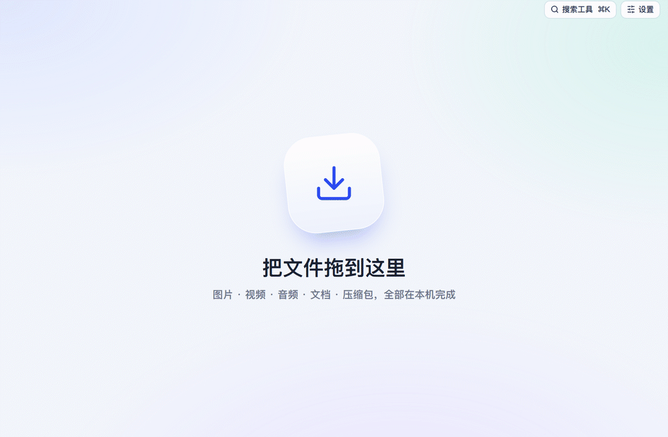
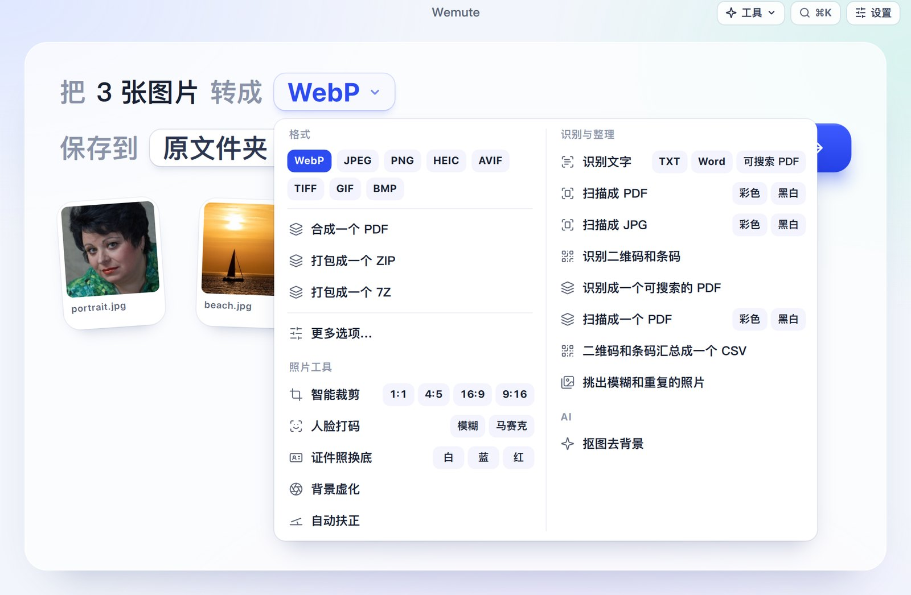
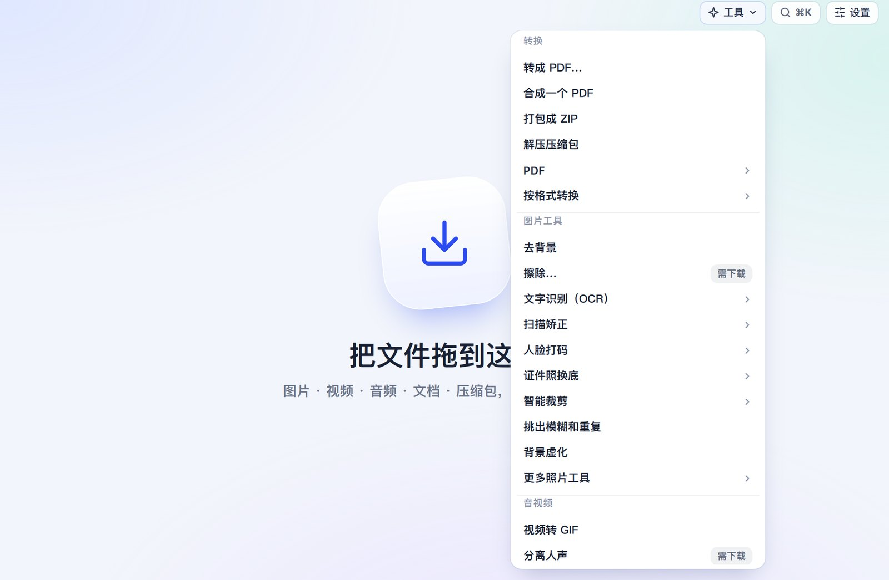
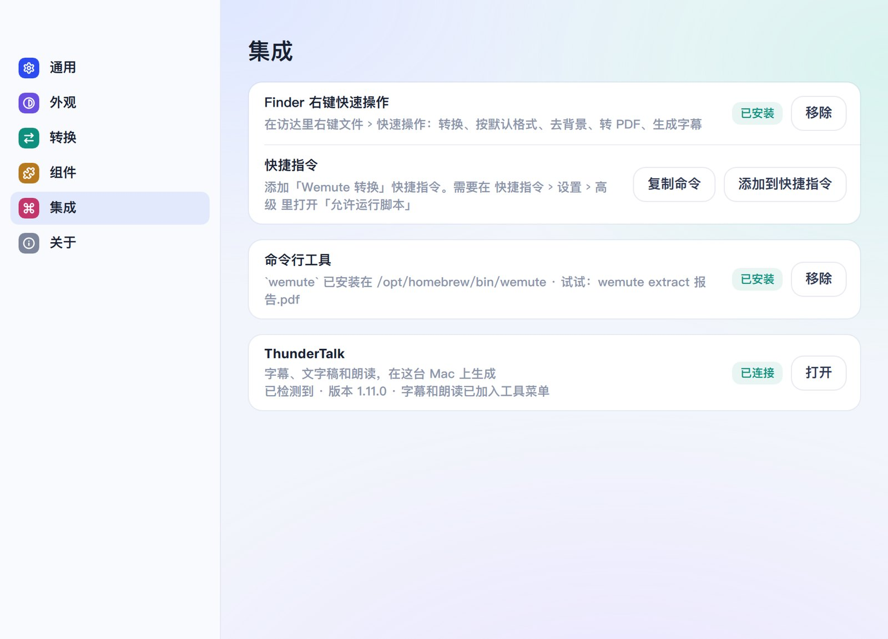

<p align="center">
  
</p>

<h1 align="center">Wemute</h1>

<p align="center">
  免费开源的 Mac 文件转换工具。<br/>
  拖进任何文件，读一句话，开始转换。<br/>
  一切都在你的 Mac 上完成：不用账号，不上传，不走云端。
</p>

<p align="center">
  <a href="README.md">English</a> · <a href="https://wemute.entropinia.com/zh">网站</a> · <a href="https://github.com/realAllenSong/wemute/releases/latest">下载</a> · <a href="docs/cli.md">命令行</a>
</p>

<p align="center">
  <a href="LICENSE"></a>
  
  <a href="https://github.com/realAllenSong/wemute/releases/latest"></a>
  <a href="https://github.com/realAllenSong/wemute/releases"></a>
</p>

<p align="center">
  
  <br/><sub>Wemute 0.7.1 在 macOS 15 上的真实截图。最后一帧的转换是在 M3 Max 上真实运行的结果，只额外加了淡入淡出。</sub>
</p>

---

Wemute 是一个 Mac 上的文件转换工具。随便拖进一批文件，每种文件占一行，比如「把 3 张图片 转成 [WebP ▾]」。在这一行里换个格式，按**开始转换**，结果就出现在原文件旁边。

- **格式**：图片、视频、音频、Word、Excel、PPT、Pages、Numbers、Keynote、PDF、电子书、压缩包、字体和数据文件。
- **照片和扫描工具**：基于 Apple Vision 框架。
- **命令行**：能把任何文件变成大模型能读的文字。

Wemute 采用 AGPL 许可证，可以看作 Permute、CloudConvert、Convertio、iLovePDF 等在线转换工具的开源、离线替代品。

界面风格叫"冰面"：浅色底上的柔和玻璃质感，只有一种钴蓝色点缀，支持浅色和深色。第一次转换之前，不需要先学会任何设置。

## v0.7.2 新功能

- **在哪台 Mac 上都能下载**：app 现在自带 HTTPS 证书。之前没装 Homebrew 的 Mac 下载不了模型和组件。
- **下载不会卡住**：连接卡住 30 秒就会放弃，自动换备用下载源。擦除和放大模型现在优先从 Wemute 自己的 GitHub 镜像下载。
- **`wemute models` 和 `wemute doctor`**：在命令行安装模型，以及一键检查这台 Mac 上哪些功能可用。

## v0.7.1 新功能

- **所有工具一个入口**：工具栏里的「工具」菜单和 ⌘K 搜索列的是同样的东西，所以去掉了「工具」菜单。**搜索工具 ⌘K** 能搜索全部工具，什么都不输入时直接列出全部。

## v0.7.0 新功能

- **首个签名版本**：使用 Developer ID 签名、经过 Apple 公证，并通过 Sparkle 自动更新。
- **`wemute extract`**：把任何文件或文件夹变成大模型能读的 Markdown、纯文本或 JSON 行。它能读出：
  - PDF 的分页和表格，扫描页自动 OCR；
  - Word 的标题、Excel 的工作表、PPT 的幻灯片和备注；
  - 截图；
  - 电话会录音，可以标出说话人；
  - 带附件的邮件、压缩包。

  详见[给脚本和 AI 智能体用](#给脚本和-ai-智能体用)。
- **字幕和朗读（借助 ThunderTalk）**：
  - 字幕可以是 SRT、VTT、文字稿，或者分说话人的文字稿；
  - 转写用你下载的最准的模型；
  - 朗读用 VoxCPM2。
- **照片工具更好用**：
  - 证件照换底和新增的背景虚化，改用 Apple 的主体抠图，换成红底、蓝底时发丝也干净；
  - 擦除大一点的物体时，不再留下残影或深色污迹。
- **和 macOS 融为一体**：
  - 访达右键快速操作、快捷指令；
  - `wemute` 命令行；
  - 设置窗口、原生菜单栏和 ⌘K 搜索。

## 功能

### 几乎什么都能转

| 文件 | 可以变成 |
|---|---|
| 图片：HEIC、JPG、PNG、WebP、AVIF、TIFF、GIF、BMP、RAW | 上述任意格式、合成一个 PDF、打包 ZIP |
| 视频：MOV、MP4、MKV、WebM、AVI | MP4 H.264 或 H.265（硬件编码）、ProRes、MKV、WebM、GIF、字幕 |
| 音频：WAV、MP3、M4A、FLAC、AIFF、OGG、Opus | 上述任意格式、文字稿 |
| Word、Pages、RTF、ODT | PDF、DOCX、ODT、RTF、TXT、HTML |
| Excel、Numbers、CSV | XLSX、CSV、JSON、PDF、ODS |
| PowerPoint、Keynote | PDF、PPTX、ODP、每页一张 PNG |
| PDF | Word、页面图片、文字、压缩 PDF、合并 PDF、可搜索 PDF |
| 电子书：EPUB、MOBI、AZW3 | EPUB、MOBI、AZW3、PDF |
| Markdown、HTML、JSON | DOCX、PDF、HTML、CSV、XLSX |
| 字体、SVG、压缩包 | WOFF2、TTF、OTF、WOFF；PNG、PDF；解压后的文件夹 |

- **记住你的选择**：每种文件在设置里都有默认格式，你每次选的格式会成为下一次的默认。
- **从不覆盖文件**：可以保存到原文件夹，也可以保存到你指定的文件夹；还可以给每个输出文件名加上"-wemute"后缀。
- **批量并行**：图片用多个核心同时处理，视频用硬件编码，文档单独排队。

<p align="center"></p>

### 基于 Apple 框架的照片和扫描工具

这些工具不用下载任何东西，在神经网络引擎上运行：

- **去背景**：Apple 的主体抠图，发丝边缘干净。
- **证件照换底**：白、蓝、红三种底色，发丝间露出的旧背景也会一起去掉。
- **背景虚化**：背景模糊，人物保持清晰。
- **文字识别（OCR）**：识别中英文，输出文字、Word 或可搜索的 PDF；扫描版 PDF 也能变成可搜索的。
- **扫描矫正**：手机拍的纸张，拉平、裁边成扫描件，可选彩色或黑白。
- **智能裁剪**：围绕主体裁成 1:1、4:5、16:9、9:16。
- **人脸打码**：模糊或马赛克。
- **自动扶正**：把拍歪的地平线扶正。
- **识别二维码和条码。**
- **挑出模糊和重复的照片。**

<p align="center"></p>

### 可选的本地模型

第一次用到时才下载：

- **图片放大** 2× 或 4×（Real-ESRGAN）。
- **擦除**：涂抹想去掉的东西（LaMa）。最适合文字、水印和小物体；复杂背景前的人物可能会糊。
- **人声分离**（Demucs，在 MLX 上运行）。

### 字幕和朗读（借助 ThunderTalk）

装了 [ThunderTalk](https://github.com/realAllenSong/ThunderTalk) 以后，Wemute 会多出两种选择：

- **字幕**：视频和音频可以生成 SRT、VTT、文字稿，或者分说话人的文字稿。用的是 ThunderTalk 里你下载的最准的模型。
- **朗读**：TXT、Markdown、Word、PDF 可以读成 M4A，声音用 VoxCPM2。

Wemute 找到 ThunderTalk 后，**设置 › 集成**里会显示**已连接**。

### 和 macOS 融为一体

- **⌘K（右上角的「搜索工具」）**：输入"转 pdf""去背景""ocr"，或直接往下翻全部工具。菜单栏里的**工具**菜单列着同样的工具。先选工具再拖文件，下一次拖进来的文件就直接用它。
- **访达快速操作**：右键文件 › 快速操作 ›「Wemute：去背景」「转成 PDF」「生成字幕」等。
- **快捷指令**：一个「Wemute 转换」快捷指令，可以接进你的自动化流程。
- **设置窗口**：外观（浅色、深色或跟随系统）、每种文件的默认格式、保存位置、可选组件。
- **Quick Look**：每个文件都有缩略图，按空格键可以预览。

| | |
|---|---|
|  |  |

## 给脚本和 AI 智能体用

`wemute extract` 能把任何文件或文件夹变成大模型能读的 Markdown、纯文本或 JSON 行。研究报告、业绩电话会、截图、表格、邮件都可以交给它。

```sh
wemute extract 季度报告.pdf                    # Markdown 输出到 stdout
wemute extract 业绩电话会.m4a --speakers       # 谁说了什么，带时间戳
wemute extract 研究资料/ --format json > docs.jsonl   # 每个文件一行 JSON
wemute convert --action remove_background *.jpg      # 不开窗口，调用任意工具
wemute actions                                       # 列出所有工具的 id
```

- stdout 只输出结果，第三方库的日志一律进 stderr。
- 退出码是 0 或 1，错误码稳定。
- 每种文件类型都有一项验收测试，在打包后的 app 上运行。

在**设置 › 集成 › 命令行工具**里安装这个命令。完整说明见 [docs/cli.md](docs/cli.md)。

## 安装

1. 从[最新版本](https://github.com/realAllenSong/wemute/releases/latest)下载 `.dmg` 安装包。
2. 打开 DMG，把 Wemute 拖进"应用程序"。
3. 把文件拖进窗口。

需要 macOS 14 或更高版本，Apple 芯片。Wemute 使用 Developer ID 签名、经过 Apple 公证，打开时不会有警告，之后会自动更新。

下面这些不随 app 打包，文件第一次需要时才提示下载：

| 组件 | 大小 | 用途 |
|---|---|---|
| LibreOffice | 约 300 MB | Office 文档、Pages、Numbers、Keynote |
| Calibre | 约 360 MB | MOBI、AZW3 |
| Pandoc | 约 40 MB | Markdown、网页转 Word |

每个组件都从官方来源下载，并按固定的 SHA-256 校验。可以在**设置 › 组件**里随时移除。

### 从源码构建

```sh
git clone https://github.com/realAllenSong/wemute.git && cd wemute
uv sync --dev
uv run wemute                      # 从源码运行
./scripts/build-macos.sh           # 构建 dist/Wemute.app（自带 FFmpeg）
./scripts/package-macos.sh         # 签名并公证的 DMG（需要 Developer ID）
```

## 网页版

最常用的图片、视频、音频转换也可以在浏览器里完成：[wemute.entropinia.com](https://wemute.entropinia.com/zh)。

- 文件不会上传。
- 图片用浏览器自带的编码器处理。
- 视频用编译成 WebAssembly 的 FFmpeg 处理。

网站源码在 [`apps/web`](apps/web)。

## 隐私

不需要账号，不上传文件，不收集遥测。文件都由你 Mac 上的进程处理。只有在下载你选择的组件或模型、以及检查 app 更新时才会联网。

## 开发

```sh
uv run pytest                          # 单元和集成测试
uv run python -m wemute --smoke-test   # 加载完整界面后退出
```

- `src/wemute/`：app（PySide6 + QML）和各个 worker。
  - `engines/`：转换引擎。
  - `extract.py`、`cli.py`：命令行。
- `apps/web/`：网页版，一个 Astro 站点，有 119 项浏览器测试。
- `docs/plans/`：每一轮开发的设计文档。

## 许可证

Wemute 是自由软件，采用 [GNU Affero 通用公共许可证 v3.0](LICENSE)。

它建立在下面这些项目之上，它们各自保留自己的许可证：

- Apple 的 Vision 和 Core Image 框架；
- FFmpeg、LibreOffice、Calibre、Pandoc；
- PyMuPDF、pdfium；
- LaMa、Real-ESRGAN、Demucs；
- Qt for Python；
- Sparkle。

**设置 › 关于**里逐一列出了这些项目，并附有许可证链接。
